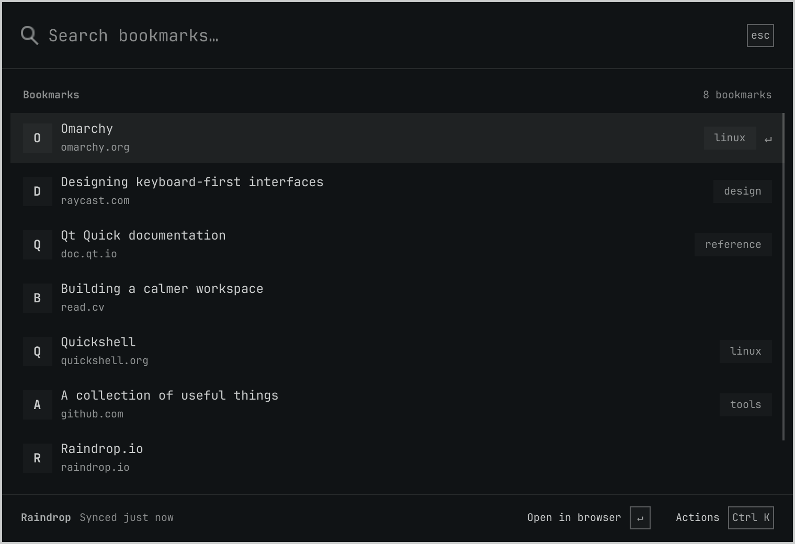

# Raindrop Bookmarks for Omarchy

A keyboard-first Omarchy Quattro overlay for searching your
[Raindrop.io](https://raindrop.io/) bookmarks. It keeps the last successful
bookmark download for offline search, caches small cover thumbnails, and uses a
letter tile when a bookmark has no usable cover.



The search-first layout takes cues from [Raycast's bookmark browser](https://www.raycast.com/raycast/browser-bookmarks).
Colors, fonts, spacing, borders, and corner rounding follow your Omarchy theme.

## Requirements

- Omarchy Quattro
- `curl`, `jq`, `file`, `python3`, `timeout`, and ImageMagick's `magick`

Install the required packages:

```sh
omarchy pkg add jq imagemagick python
```

## Install

```sh
omarchy plugin add https://github.com/treramey/omarchy-raindrop-bookmarks.git --enable
```

Open the overlay and paste your Raindrop test token when prompted. The plugin
links to the Raindrop integrations menu, verifies the token, and stores it at
`${XDG_CONFIG_HOME:-$HOME/.config}/raindrop/token` with private permissions.

To open the overlay from a terminal:

```sh
omarchy-shell shell toggle io.github.treramey.raindrop-bookmarks '{}'
```

To store the token elsewhere, set `RAINDROP_TOKEN_FILE` before you start
Omarchy Shell.

### Connection errors

The form distinguishes rejected tokens, invalid input, connection failures,
Raindrop service errors, and local installation or save failures. A rejected
replacement never overwrites the saved token. Save failures return you to the
form so you can retry.

If a background check is still running, the form shows `Finishing check…`.
Wait for it to finish before submitting the replacement token. Active attempts
continue if you close the overlay. Reopening does not restart them.

Rate limits show a retry countdown and disable Connect until the wait ends.
Token checks have a 20-second deadline and saves have a 5-second deadline.

## Keyboard shortcut

To use `Super + Shift + R`, add this binding to
`~/.config/hypr/bindings.lua`:

```lua
hl.unbind("SUPER + SHIFT + R")
o.bind(
  "SUPER + SHIFT + R",
  "Raindrop bookmarks",
  "omarchy-shell shell toggle io.github.treramey.raindrop-bookmarks '{}'"
)
```

This replaces any existing `Super + Shift + R` binding. Change the key
combination if you already use it, then reload Hyprland:

```sh
hyprctl reload
```

## Use

- Type to fuzzy-search titles, domains, tags, and URLs.
- Use `Up`, `Down`, `Page Up`, and `Page Down` to move through results.
- Press `Enter` to open the selected bookmark.
- Press `Ctrl+K` or click `Actions` for bookmark and connection actions.
- Press `Ctrl+R` to refresh bookmarks.
- Press `Escape` to dismiss actions, clear the query, then close the overlay.
- Click outside the card to close it.
- Choose `Refresh bookmarks` in `Actions` to request a manual refresh.
- Choose `Reconnect Raindrop` in `Actions` when the saved token is no longer valid.

## Data and security

Omarchy plugins run unsandboxed with your user permissions. This plugin:

- reads credentials only from the configured Raindrop token file;
- sends that token only to `https://api.raindrop.io`;
- stores the last complete bookmark response under
  `${XDG_DATA_HOME:-$HOME/.local/share}/omarchy-shell/raindrop-bookmarks`;
- binds saved bookmarks to a local SHA-256 fingerprint of the token without
  storing the token in the snapshot;
- downloads only HTTPS cover URLs on port 443 whose DNS answers are all public;
- pins each cover request to its validated address, disables redirects and
  proxies, and enforces strict connection, transfer-time, and 5 MiB limits;
- accepts only PNG, JPEG, GIF, and WebP covers and processes them under a
  restrictive ImageMagick resource and codec policy;
- caps each ImageMagick process's virtual address space at 256 MiB before
  identification or conversion, preserves stricter inherited limits, and includes
  metadata allocations outside ImageMagick's pixel cache in that budget;
- stores generated thumbnails under
  `${XDG_CACHE_HOME:-$HOME/.cache}/omarchy-shell/raindrop-bookmarks/covers`; and
- opens selected links through `xdg-open`.

The plugin never copies the token into its directory or exposes it in a process
argument. During cover sync, it attempts to refresh thumbnails at least seven
days old and deletes thumbnail files with a modification age greater than 30
days. These checks do not run on a timer. It refreshes bookmark data in the
background when you open the overlay and the last successful sync is at least
five minutes old. A failed refresh keeps the last successful snapshot.

To clear the saved bookmark snapshot and cover cache without removing your
token, run `clear-bookmarks` from the installed plugin directory:

Stop Omarchy Shell before clearing data. Closing the overlay does not stop
background syncs. The command deletes files, but does not clear bookmarks from
a running shell's memory or prevent an active sync from recreating the files.
Start Omarchy Shell again when finished. Opening the plugin can download the
bookmarks again while the token remains configured.

```sh
"${XDG_CONFIG_HOME:-$HOME/.config}/omarchy/plugins/io.github.treramey.raindrop-bookmarks/clear-bookmarks"
```

## Remove

```sh
"${XDG_CONFIG_HOME:-$HOME/.config}/omarchy/plugins/io.github.treramey.raindrop-bookmarks/clear-bookmarks"
omarchy plugin remove io.github.treramey.raindrop-bookmarks
```

The clear command removes the saved snapshot and cover cache. The removal
command leaves the configured token file in place because other Raindrop tools
might use it. Remove that file yourself if you no longer need it.

## Development

Test the onboarding flow from the current checkout. The script restores your
installed plugin and token when you finish:

The script does not back up or restore bookmark snapshots or cover caches.
Connecting during the test can replace those files with data for the test token.

```sh
scripts/test-onboarding.sh
```

Or run the checks directly:

```sh
omarchy plugin validate .
qmllint -I "$OMARCHY_PATH/shell" RaindropBookmarks.qml BookmarkBrowser.qml RaindropConnection.qml
for script in configure-token validate-token token-fingerprint load-bookmarks bookmark-sync clear-bookmarks cover-sync scripts/*.sh tests/*.sh; do
  bash -n "$script" || break
done
python3 -m py_compile validate-cover-url
tests/configure-token.sh
tests/validate-token.sh
tests/raindrop-connection.sh
tests/bookmark-sync.sh
tests/security.sh
tests/bookmark-browser.sh
tests/quickshell-theme.sh
```

Runtime changes require a Changesets entry (`pnpm changeset`). The release pull
request updates `package.json` and `manifest.json`. Use Conventional Commit
subjects.

Changesets tooling requires `pnpm install`. Its local `node_modules` tree
contains symlinks, which Omarchy's plugin validator intentionally rejects.
Remove it before validating the plugin folder:

```sh
rm -rf node_modules
omarchy plugin validate .
```

See the Omarchy marketplace guides for
[development](https://omarchyplugins.com/develop.html) and
[publishing](https://omarchyplugins.com/publish.html).
